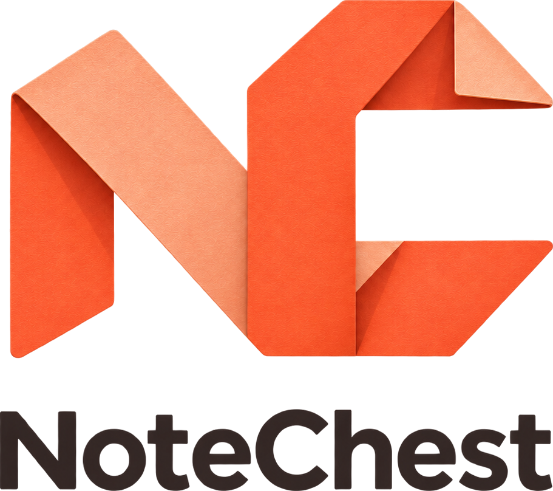

<p align="center">
  <picture>
    <source media="(prefers-color-scheme: dark)" srcset="assets/brand/notechest/notechest-stacked-light.png">
    
  </picture>
</p>

# NoteChest

Un fichero de tarjetas digital y moderno para tus notas. Es nativo, rápido y privado: está escrito en Rust con [GPUI](https://gpui.rs), el
framework de UI del editor [Zed](https://zed.dev).

> **Antes Cardfile.** El proyecto pasó a llamarse NoteChest en la 2.0.0; mirá
> [Si venís de Cardfile](#si-venís-de-cardfile). English: [README.md](README.md)

## Funciones

- Editor tipo Word: títulos, listas, checklists, tablas, bloques de código, colores, imágenes y
  adjuntos. No hace falta aprender Markdown, y cada tarjeta se puede exportar a Markdown.
- Búsqueda de texto completo en títulos y contenido.
- Etiquetas, favoritos, tarjetas fijadas, orden manual e historial de versiones.
- Niveles de protección por tarjeta: **solo lectura** (evita ediciones por error), **privada**
  (pide contraseña para verla) y **cifrada** (se guarda cifrada).
- Modo multiusuario, de contraseña única o sin contraseña, elegido en el primer arranque.
- Papelera, temas, atajos de teclado configurables y paleta de comandos.
- Exportación a Markdown, HTML, PDF y JSON.
- Modo portable, para llevar tus tarjetas en un pendrive.
- Compartir tarjetas con otros usuarios (ver o editar); cada usuario tiene su propia contraseña
  de bloqueo y sus claves.
- Asistente de IA opcional con tu propia IA en la nube o local (OpenAI, Claude, Gemini, Ollama,
  LM Studio y más): buscá, reescribí, formateá, etiquetá y reordená tarjetas conversando. No se
  muestra hasta que lo configurás.
- Servidor MCP integrado y API keys, para que apps de IA como Claude o Cursor usen tus tarjetas;
  cada cambio de la IA queda registrado a su nombre y se puede deshacer.
- El audio adjunto se reproduce dentro de la tarjeta; el video se abre con el reproductor del
  sistema. Arrastrá imágenes y archivos entre tarjetas.
- Chino, japonés, coreano y escrituras de derecha a izquierda (hebreo, árabe, persa).
- Interfaz en 21 idiomas.
- Sin telemetría.

> **Sobre las traducciones:** todas las traducciones distintas del inglés fueron hechas con IA.
> Pedimos disculpas por los errores que puedan tener y agradecemos los reportes para corregirlos:
> [abrí un issue](https://github.com/FittyAr/NoteChest/issues).

## Instalación

**Windows (PowerShell)**

```powershell
irm https://raw.githubusercontent.com/FittyAr/NoteChest/main/install.ps1 | iex
```

**Linux**

```bash
curl -fsSL https://raw.githubusercontent.com/FittyAr/NoteChest/main/install.sh | sh
```

Los instaladores de una línea siempre instalan la release **más nueva** (estable, o la
pre-release más nueva mientras no haya una estable más reciente), verifican su SHA-256 y su firma
minisign, y agregan NoteChest al menú Inicio / menú de aplicaciones y al escritorio. Todo queda dentro de una carpeta `FittyAr` (`%LOCALAPPDATA%\Programs\FittyAr\NoteChest`,
`~/.local/lib/FittyAr/NoteChest`), igual que tus tarjetas (`%APPDATA%\FittyAr\NoteChest`,
`~/.local/share/FittyAr/NoteChest`). No hacen falta
permisos de administrador y después NoteChest se actualiza solo desde la app. Opciones:

| | Windows | Linux |
|---|---|---|
| Solo releases estables | `-Stable` | `--stable` |
| Una versión concreta | `-Version v2.0.0` | `--version v2.0.0` |
| Sin acceso en el escritorio | `-NoDesktopShortcut` | `--no-desktop-shortcut` |
| Desinstalar | `-Uninstall` (o *Configuración → Aplicaciones*) | `--uninstall` |

En Windows las opciones se pasan con
`& ([scriptblock]::Create((irm https://raw.githubusercontent.com/FittyAr/NoteChest/main/install.ps1))) -Stable`;
en Linux con `curl … | sh -s -- --stable`.


En Windows, PowerShell delega en el mismo instalador `.exe` verificado. El instalador
gráfico ofrece crear una carpeta portable en pendrive o OneDrive. Desde PowerShell:

```powershell
& ([scriptblock]::Create((irm https://raw.githubusercontent.com/FittyAr/NoteChest/main/install.ps1))) -Portable -Destination "E:\NoteChest"
```

Para incluir la colección actual, usá Configuración → Datos → Create portable copy como
administrador. El ZIP sigue disponible. Cerrá NoteChest y esperá la sincronización de
OneDrive antes de abrir la carpeta portable en otro equipo.

**Windows (winget)**

```powershell
winget install FittyAr.NoteChest
```

Cada [release](https://github.com/FittyAr/NoteChest/releases) también incluye `.deb`, `.rpm`,
AppImage y el instalador de Inno Setup. Microsoft Store y los repositorios de Linux están en
camino.

## Si venís de Cardfile

NoteChest es el nuevo nombre de Cardfile 2 (el nombre anterior ya estaba tomado en la Microsoft
Store). Tus tarjetas vienen con vos:

- **Tus datos se adoptan solos** la primera vez que arranca NoteChest: la carpeta de datos
  `FittyAr/Cardfile` pasa a `FittyAr/NoteChest`, `cardfile.db` pasa a `notechest.db` y las claves de
  API de los servicios de IA guardadas en el almacén de credenciales del sistema se traen
  consigo. No se vuelve a cifrar nada, así que las tarjetas cifradas y compartidas siguen
  funcionando. Las carpetas viejas nunca se borran ni se mezclan.
- **Instalar NoteChest sobre Cardfile lo reemplaza**: una sola entrada en Aplicaciones y un solo
  acceso directo. Los instaladores de una línea hacen lo mismo y quitan los archivos viejos del
  programa.
- **Las actualizaciones desde la app no atraviesan el cambio de nombre.** Las betas 2.0.0 de
  Cardfile buscan versiones con los nombres viejos: instalá NoteChest una vez con el instalador o
  con el comando de una línea; desde ahí se actualiza solo.
- Las copias de seguridad anteriores conservan su nombre `cardfile-…`, siguen contando para la
  retención y se pueden restaurar.
- El servidor MCP ahora se llama `notechest` en las configuraciones de cliente que escribe
  NoteChest. Si agregaste `cardfile` a Claude Desktop, VS Code u otro, agregá NoteChest de nuevo y
  quitá la entrada vieja.
- El proyecto vive en <https://github.com/FittyAr/NoteChest>; los enlaces viejos redirigen.

## Documentación

- [Guía de usuario](docs/GUIA_DE_USUARIO.md)

## Compilar desde el código fuente

Necesitás la última versión estable de [Rust](https://rustup.rs).

```bash
git clone https://github.com/FittyAr/NoteChest
cd NoteChest
cargo run --release
```

## Licencia

Podés usarlo bajo [Apache 2.0](LICENSE-APACHE) o [MIT](LICENSE-MIT), a tu elección. Los créditos
de terceros están en [docs/CREDITS.md](docs/CREDITS.md).
