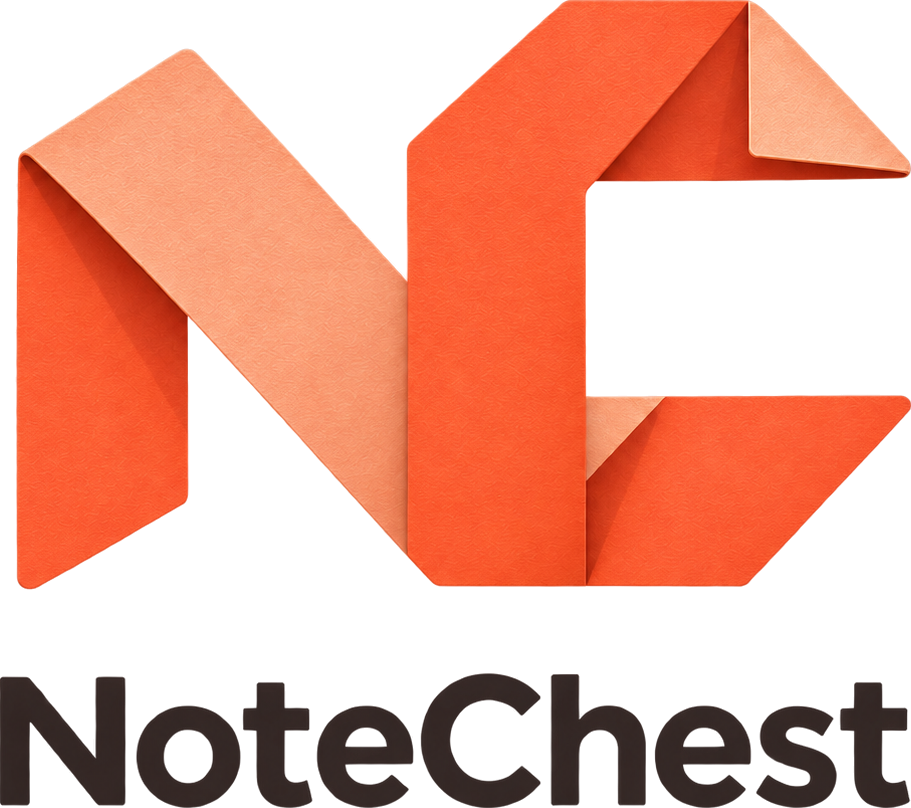

<p align="center">
  <picture>
    <source media="(prefers-color-scheme: dark)" srcset="assets/brand/notechest/notechest-stacked-light.png">
    
  </picture>
</p>

# NoteChest

A modern digital card file for your notes.
Native, fast and private: written in Rust with [GPUI](https://gpui.rs), the UI framework behind
the [Zed](https://zed.dev) editor.

> **Formerly Cardfile.** The project was renamed NoteChest in 2.0.0; see
> [Coming from Cardfile](#coming-from-cardfile). Español: [README.es.md](README.es.md)

## Features

- Word-like editor: headings, lists, checklists, tables, code blocks, colors, images and
  attachments. No Markdown syntax to learn, and every card exports to Markdown.
- Full-text search across titles and contents.
- Tags, favorites, pinned cards, manual ordering and version history.
- Card protection levels: **read-only** (no accidental edits), **private** (password to view)
  and **encrypted** (encrypted at rest).
- Multi-user, single-password or password-free mode, chosen on first run.
- Recycle bin, themes, configurable keyboard shortcuts and a command palette.
- Export to Markdown, HTML, PDF and JSON.
- Portable mode, so you can carry your cards on a USB drive.
- Share cards with other users (view or edit); every user has their own lock password and keys.
- Optional AI assistant with your own cloud or local AI (OpenAI, Claude, Gemini, Ollama, LM Studio
  and more): search, rewrite, format, tag and reorder cards by chat. Hidden until you set it up.
- Built-in MCP server and API keys, so AI apps like Claude or Cursor can use your cards; every AI
  change is attributed to the AI and can be undone.
- Audio attachments play inside the card; video opens in your system player. Drag images and
  files between cards.
- Chinese, Japanese, Korean and right-to-left scripts (Hebrew, Arabic, Persian).
- 21 interface languages.
- No telemetry.

> **About translations:** every translation other than English was made with AI. We apologize
> for any mistakes and we are grateful for reports so we can fix them: please
> [open an issue](https://github.com/FittyAr/NoteChest/issues).

## Install

**Windows (PowerShell)**

```powershell
irm https://raw.githubusercontent.com/FittyAr/NoteChest/main/install.ps1 | iex
```

**Linux**

```bash
curl -fsSL https://raw.githubusercontent.com/FittyAr/NoteChest/main/install.sh | sh
```

The one-line installers always install the **newest** release (stable, or the newest pre-release
while there is no newer stable one), verify its SHA-256 and minisign signature, and add NoteChest to
the Start menu / application menu and the desktop. Everything goes under a `FittyAr` folder (`%LOCALAPPDATA%\Programs\FittyAr\NoteChest`, `~/.local/lib/FittyAr/NoteChest`), and so do your cards (`%APPDATA%\FittyAr\NoteChest`, `~/.local/share/FittyAr/NoteChest`). No administrator rights are needed, and
NoteChest then updates itself from inside the app. Options:

| | Windows | Linux |
|---|---|---|
| Only stable releases | `-Stable` | `--stable` |
| A specific version | `-Version v2.0.0` | `--version v2.0.0` |
| No desktop shortcut | `-NoDesktopShortcut` | `--no-desktop-shortcut` |
| Uninstall | `-Uninstall` (or *Settings → Apps*) | `--uninstall` |

On Windows pass options with
`& ([scriptblock]::Create((irm https://raw.githubusercontent.com/FittyAr/NoteChest/main/install.ps1))) -Stable`;
on Linux with `curl … | sh -s -- --stable`.


On Windows, PowerShell delegates to the same verified `.exe` setup. The graphical setup
also offers a portable folder for a USB drive or OneDrive. To prepare one from PowerShell:

```powershell
& ([scriptblock]::Create((irm https://raw.githubusercontent.com/FittyAr/NoteChest/main/install.ps1))) -Portable -Destination "E:\NoteChest"
```

To include your existing collection, use Settings → Data → Create portable copy as an
administrator. The ZIP download remains available. Close NoteChest and finish OneDrive
synchronization before opening the portable folder on another computer.

**Windows (winget)**

```powershell
winget install FittyAr.NoteChest
```

`.deb`, `.rpm`, AppImage and the Inno Setup installer are attached to every
[release](https://github.com/FittyAr/NoteChest/releases). Microsoft Store and Linux repositories
are coming.

### Verifying downloads

Release files are signed with [minisign](https://jedisct1.github.io/minisign/):

```bash
minisign -Vm <file> -P <public key from docs/SIGNING.md>
```

The Windows executables are not Authenticode-signed (only the Microsoft Store package is), so
SmartScreen may warn on first run.

## Coming from Cardfile

NoteChest is the new name of Cardfile 2 (the old name was already taken in the Microsoft
Store). Your cards come with you:

- **Your data is adopted automatically** the first time NoteChest starts: the `FittyAr/Cardfile`
  data folder becomes `FittyAr/NoteChest`, `cardfile.db` becomes `notechest.db`, and the API keys of
  AI services in the system credential store are carried over. Nothing is re-encrypted, so
  encrypted and shared cards keep working. Old folders are never deleted or merged.
- **Installing NoteChest over Cardfile replaces it**: one entry in Apps, one shortcut. The one-line
  installers do the same and remove the old program files.
- **In-app updates do not cross the rename.** Cardfile 2.0.0 betas look for releases under the old
  names, so install NoteChest once with the installer or the one-line command; after that it
  updates itself.
- Backups made before keep their `cardfile-…` names, still count towards retention and can be
  restored.
- The MCP server is now called `notechest` in the client configurations NoteChest writes. If you
  added `cardfile` to Claude Desktop, VS Code or similar, add NoteChest again and remove the old
  entry.
- The project lives at <https://github.com/FittyAr/NoteChest>; the old links redirect.

## Documentation

- [User guide](docs/USER_GUIDE.md)
- [Releasing](docs/RELEASING.md) and [verifying downloads](docs/SIGNING.md)

## Build from source

Requires the latest stable [Rust](https://rustup.rs).

```bash
git clone https://github.com/FittyAr/NoteChest
cd NoteChest
cargo run --release
```

Linux needs the system packages listed in [AGENTS.md](AGENTS.md#commands).

## Contributing

See [CONTRIBUTING.md](CONTRIBUTING.md). The roadmap and architecture are in
[docs/PLAN.md](docs/PLAN.md).

## License

Licensed under either of [Apache License, Version 2.0](LICENSE-APACHE) or
[MIT license](LICENSE-MIT), at your option.

Third-party software and credits: [docs/CREDITS.md](docs/CREDITS.md). Every release ships
`THIRD_PARTY_LICENSES.html`.
